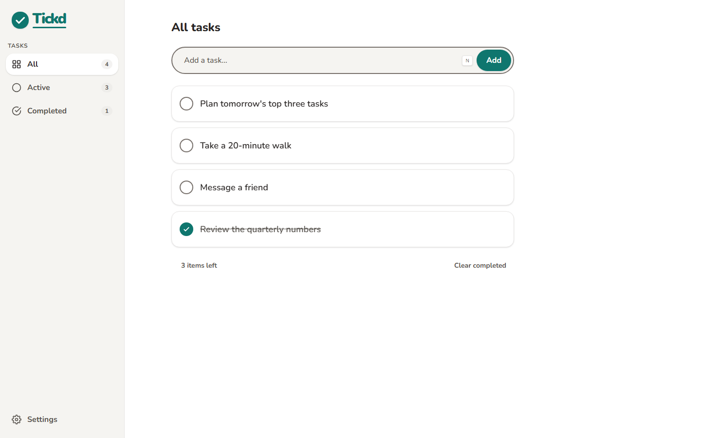
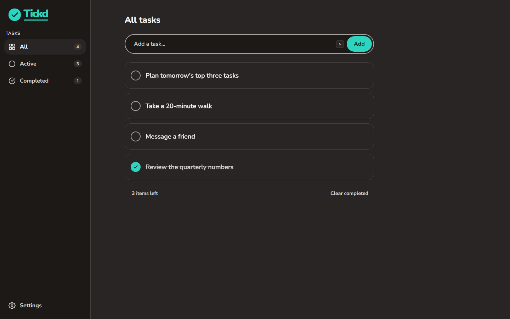
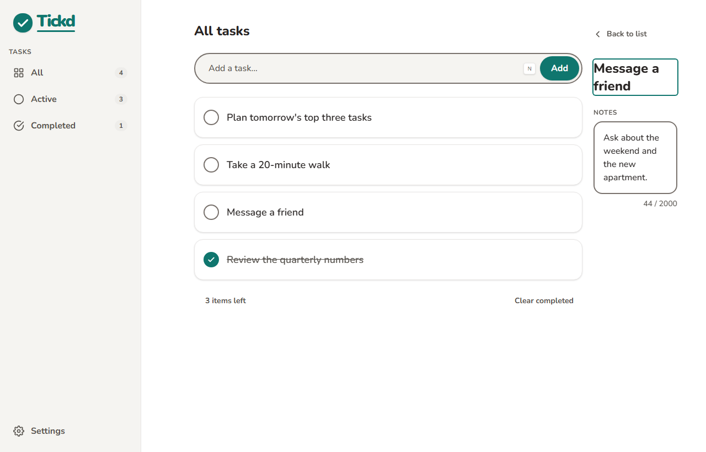
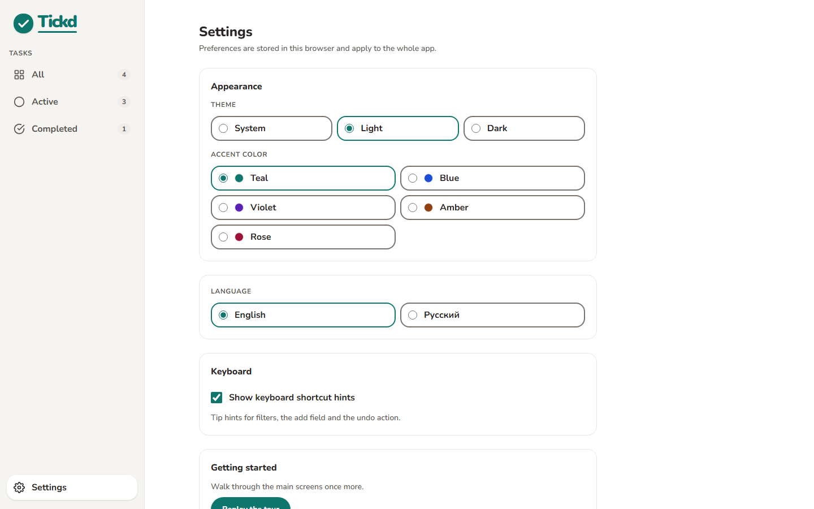
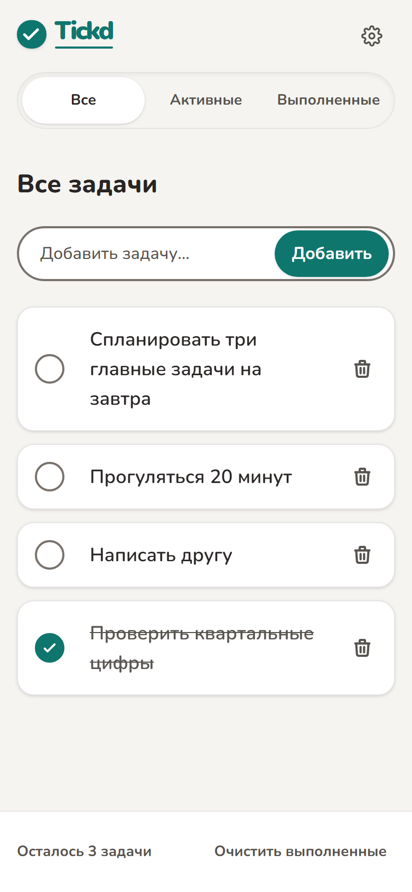
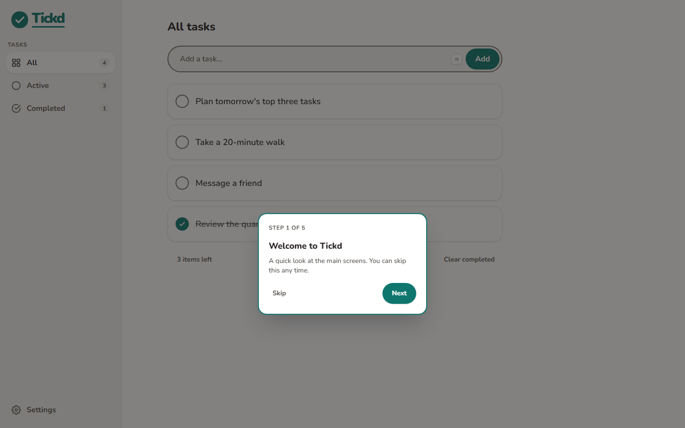
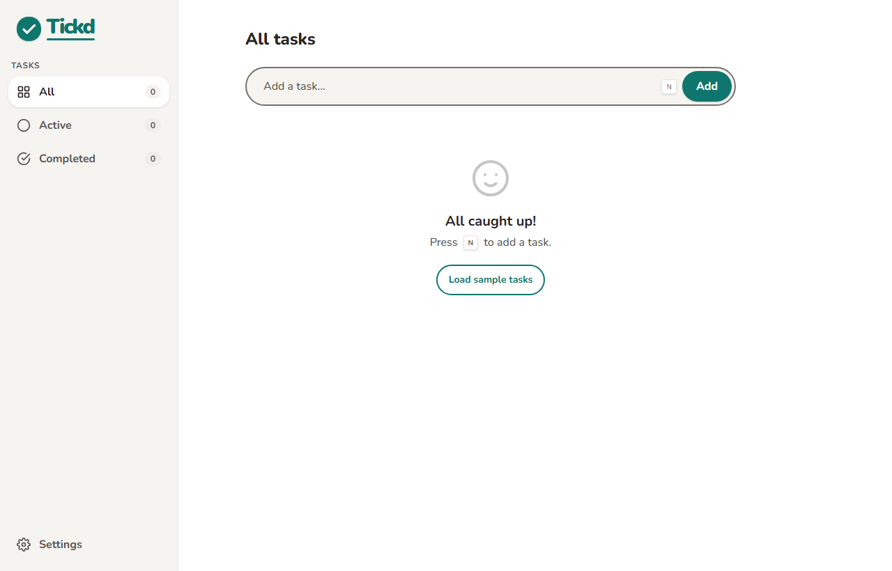
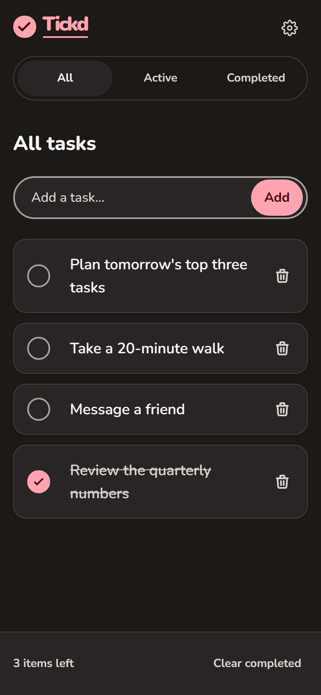
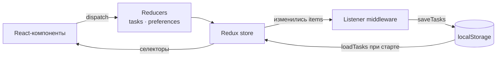
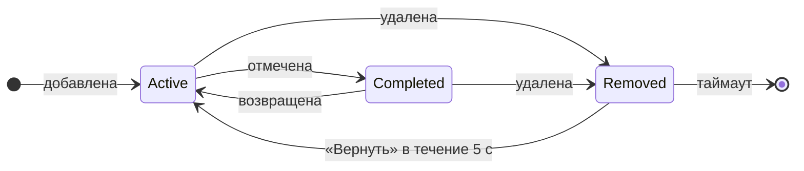

# Tickd

<p align="left">
  <a href="LICENSE"></a>
  
  
  
  
</p>

**Менеджер личных задач, который живёт в браузере.** Без регистрации, аккаунтов и сервера:
открыли страницу — и список задач готов к работе. Данные остаются в браузере пользователя.

Tickd нужен тем, кому достаточно короткого списка дел и кто не хочет ради него ставить
приложение или заводить аккаунт: задачи, заметки к ним, фильтры по статусу, отмена удаления,
горячие клавиши, тёмная тема и два языка интерфейса.

<p align="center">
  
  
</p>

## Содержание

- [Возможности](#возможности)
- [Как это устроено](#как-это-устроено)
- [Быстрый старт](#быстрый-старт)
- [Как пользоваться](#как-пользоваться)
- [Технологии](#технологии)
- [Документация](#документация)
- [Состояние проекта](#состояние-проекта)
- [Данные и приватность](#данные-и-приватность)
- [Ограничения текущей версии](#ограничения-текущей-версии)
- [Публикация](#публикация)
- [Лицензия](#лицензия)


## Возможности

**Работа со списком**

- Добавление задач: заголовок до 200 символов, пробелы по краям обрезаются, пустая задача
  не создаётся.
- Отметка «выполнено» и удаление одной задачи; «Очистить выполненные» убирает сразу все
  завершённые.
- Отмена удаления: после удаления на 5 секунд появляется уведомление с кнопкой «Вернуть»
  (или клавиша `z`). Отменить можно последнее удаление.
- Переименование: двойной клик по названию или `Enter` на нём, `Enter` — сохранить,
  `Esc` — отменить. Пустое название не сохраняется.
- Счётчик активных задач с правильными формами множественного числа для русского
  и английского.

**Фильтры и ссылки**

- «Все», «Активные» и «Выполненные» — это настоящие маршруты (`/`, `/active`,
  `/completed`), поэтому работают кнопки браузера «назад» и «вперёд», а ссылку на список
  можно отправить.
- Карточка задачи открывается по адресу `/tasks/<id>` или `/<фильтр>/tasks/<id>`; удалённая
  или неизвестная задача возвращает к списку.

**Заметки**

- У каждой задачи есть заметки до 2000 символов: панель справа на широком экране,
  полноэкранная карточка на телефоне. Поле растёт вместе с текстом и дальше прокручивается
  внутри себя.

**Настройки**

- Тема: системная, светлая или тёмная — без вспышки при загрузке страницы.
- Пять акцентных палитр; контраст каждой пары проверяется тестами по WCAG AA.
- Язык интерфейса: русский и английский.
- Переключатель подсказок горячих клавиш.

**Знакомство и примеры**

- При первом визите открывается короткий гид с подсветкой элементов: «Далее», «Назад»,
  «Пропустить», закрытие по `Esc`. Гид можно пройти заново из настроек.
- В пустом списке есть кнопка «Загрузить примеры задач» — три готовые задачи на текущем
  языке; повторное нажатие не создаёт дубликатов.

**Надёжность и доступность**

- Данные хранятся в `localStorage` в версионированном формате с миграциями; повреждённые
  или устаревшие данные не роняют приложение.
- Понятные сообщения, если браузерное хранилище заполнено, недоступно (например, в приватном
  режиме) или сохранённый список не удалось прочитать.
- Интерфейс рассчитан на экраны от 320 px; интерактивные цели заданы размером 44 px
  и проверяются на мобильных ширинах e2e-тестом. Анимации отключаются при
  `prefers-reduced-motion`.
- Проверки доступности в e2e-тестах (axe): маршруты фильтров, карточка задачи, настройки,
  пустое состояние, режим переименования и видимое уведомление об отмене; настройки
  дополнительно проверяются в обеих темах и обоих языках.
- Строгая политика CSP, валидация сохранённых данных схемой Valibot, запрет
  `dangerouslySetInnerHTML` закреплён линтером.

<p align="center">
  
  
</p>

<p align="center">
  
  
  
  
</p>

## Как это устроено

Один экран, три слоя ответственности: компоненты рисуют, Redux хранит домен, а отдельный
listener сохраняет изменения в `localStorage`. Сеть не участвует вообще.



Фильтр — это маршрут, а не состояние компонента, поэтому адресом можно поделиться,
а кнопки браузера работают ожидаемо. Каждая задача проходит короткий путь:



Подробнее — в [обзоре архитектуры](docs/architecture.md): там разобраны формат хранения,
миграции, CSP, устройство гида и последовательности сохранения и загрузки.

## Быстрый старт

Нужен Node.js 22.22 или новее.

```bash
npm ci
npm run dev
```

Приложение откроется на `http://localhost:5173`. Подробности — в
[инструкции для разработчика](docs/development.md).

### Сборка

```bash
npm run build     # проверка типов и production-сборка в dist/
npm run preview   # локальный просмотр собранной версии
```

## Как пользоваться

Коротко: введите задачу в поле сверху и нажмите `Enter`. Отметьте её кружком, когда она
сделана; клик по названию откроет заметки, двойной клик — переименование. Фильтры слева
(на телефоне — сверху) переключают список, настройки — тема, акцент и язык.

Полное руководство со скриншотами и горячими клавишами:
[docs/user-guide.md](docs/user-guide.md).

| Клавиши         | Действие                                |
| --------------- | --------------------------------------- |
| `/` или `N`     | Перейти к полю добавления задачи        |
| `1` / `2` / `3` | Все / Активные / Выполненные            |
| `Z`             | Вернуть последнюю удалённую задачу      |
| `Enter`         | Сохранить задачу или переименование     |
| `Esc`           | Отменить переименование или закрыть гид |

Горячие клавиши не срабатывают, пока курсор в поле ввода; подсказки можно отключить
в настройках.

## Технологии

React 19 с React Compiler · TypeScript (strict) · Vite · Redux Toolkit · React Router ·
Tailwind CSS v4 · Valibot · i18next · Vitest и Testing Library · Playwright с axe · Biome.

Почему выбран каждый инструмент — в [архитектурных решениях](docs/adr/).

## Документация

| Документ                                       | О чём                                                     |
| ---------------------------------------------- | --------------------------------------------------------- |
| [Руководство пользователя](docs/user-guide.md) | Возможности, сценарии, горячие клавиши, данные в браузере |
| [Архитектура](docs/architecture.md)            | Слои, состояние, маршруты, хранение, диаграммы сценариев  |
| [Разработка](docs/development.md)              | Локальный запуск, сборка, тесты, структура, публикация    |
| [Роадмап](docs/roadmap.md)                     | Что сделано и что планируется дальше                      |
| [ADR](docs/adr/)                               | Принятые архитектурные решения и их альтернативы          |

Полный список документов — в [docs/README.md](docs/README.md).

## Состояние проекта

Основные пользовательские сценарии реализованы и покрыты тестами: добавление, выполнение
и удаление задач, фильтры как маршруты, переименование, отмена удаления, заметки
к задачам, настройки внешнего вида и языка, знакомство при первом визите. Приложение
собирается в статические файлы и не требует сервера; для публикации на GitHub Pages
добавлен workflow, который включается одним переключателем в настройках репозитория.

Дальнейшие направления — синхронизация между вкладками, перетаскивание задач, PWA,
сроки и списки — перечислены в [роадмапе](docs/roadmap.md).

## Данные и приватность

Задачи, заметки и настройки лежат в `localStorage` браузера под ключами `tickd:tasks`
и `tickd:preferences`. Приложение не отправляет их на сервер, не требует аккаунта
и не использует внешние шрифты и CDN. Очистка данных сайта в браузере удаляет и задачи —
резервного копирования пока нет.

## Ограничения текущей версии

- Нет синхронизации между устройствами и вкладками, аккаунтов и облачного хранения.
- Нет сроков, напоминаний, повторяющихся задач, проектов и списков, поиска и статистики.
- Нет офлайн-режима и установки как приложения (PWA), импорта и экспорта данных.
- Перетаскивание задач для изменения порядка не реализовано.

Планы и приоритеты — в [роадмапе](docs/roadmap.md).

## Публикация

Сайт собирается и публикуется на GitHub Pages workflow
[`.github/workflows/deploy-pages.yml`](.github/workflows/deploy-pages.yml). Он запускается
на push в `main` и вручную, прогоняет линтер, проверку типов, unit-тесты и сборку
с базовым путём `/<репозиторий>/`, добавляет запасной документ для глубоких ссылок
([ADR 0009](docs/adr/0009-deep-links-fallback-via-index-copy.md)) и публикует `dist/`.

Демо: **https://leshberz.github.io/tickd/** — адрес заработает после первого успешного
запуска workflow и включения Pages в настройках репозитория
(**Settings → Pages → Build and deployment → Source: GitHub Actions**). Как это устроено
локально — в [инструкции для разработчика](docs/development.md#публикация-на-github-pages).

## Лицензия

Проект распространяется под [MIT](LICENSE): код можно свободно использовать, изменять
и распространять, в том числе в закрытых продуктах, при сохранении уведомления об авторстве.
Программа предоставляется «как есть», без гарантий.

Почему MIT и как выглядят альтернативы (Apache-2.0, GPL-3.0, AGPL-3.0) — в
[docs/licensing.md](docs/licensing.md).
