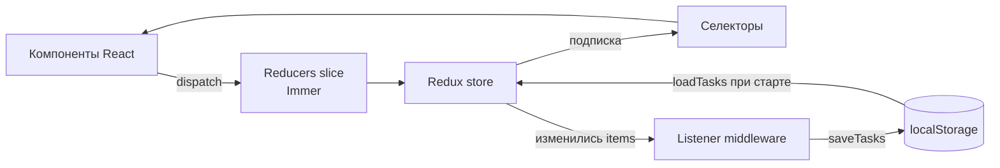
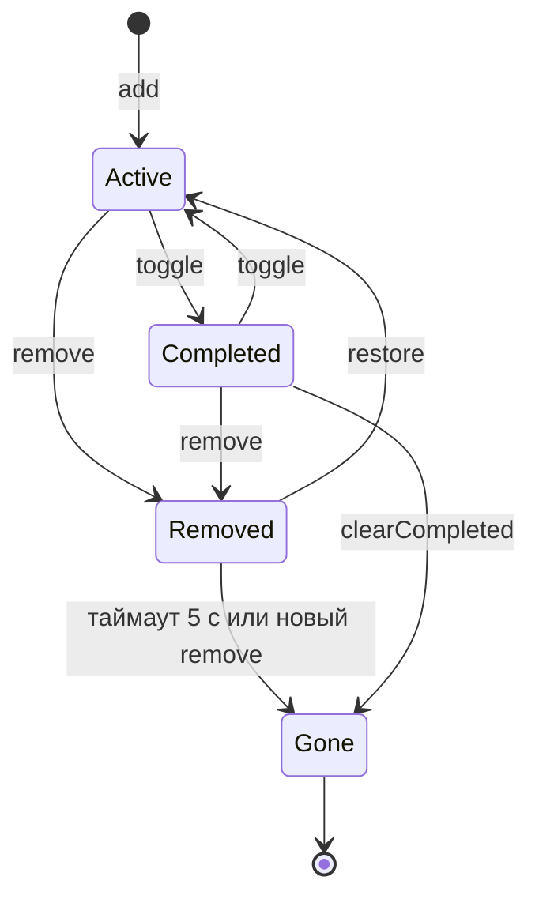
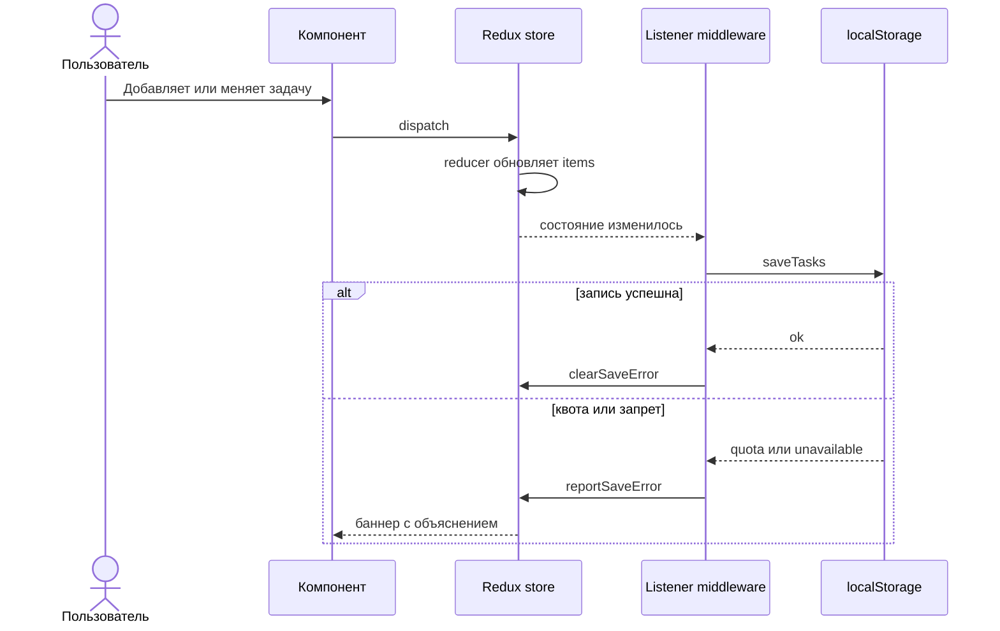
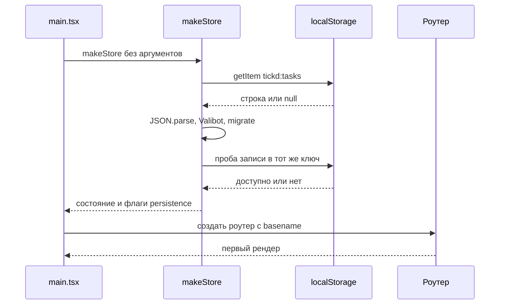

# Архитектура

Обзор технического устройства Tickd: из каких слоёв состоит приложение, как проходит
состояние, где и в каком формате хранятся данные. Архитектурные решения и их альтернативы
зафиксированы в [ADR](adr/); этот документ описывает итоговую картину, а не историю выбора.

## Что это за приложение

Статическое клиентское приложение без бэкенда. Сборка Vite выдаёт набор файлов, которые
раздаются любым статическим хостингом; в качестве основного варианта используется
GitHub Pages. Всё состояние живёт в браузере: Redux store в памяти и `localStorage`
между сессиями. Сетевых запросов за данными нет.

Из этого следуют три ограничения, которые определяют архитектуру:

- **Нет сервера** — авторизации, синхронизации и серверной валидации нет; данные
  пользователя валидируются на клиенте.
- **URL статические** — маршрутизация клиентская, глубокие ссылки требуют запасного
  варианта на хостинге ([ADR 0004](adr/0004-routing-on-github-pages.md),
  [ADR 0009](adr/0009-deep-links-fallback-via-index-copy.md)).
- **Хранилище недоверенное** — `localStorage` может содержать что угодно, поэтому чтение
  проходит через схему и миграции ([ADR 0003](adr/0003-versioned-storage-schema-with-valibot.md)).

## Слои

| Слой        | Где лежит                   | Ответственность                                                       |
| ----------- | --------------------------- | --------------------------------------------------------------------- |
| Точка входа | `src/main.tsx`              | Создаёт store и роутер, применяет сохранённый язык до первого рендера |
| Оболочка    | `src/app/`                  | Store, слушатели, маршруты, layout, горячие клавиши, логотип          |
| Домен задач | `src/features/tasks/`       | Slice, селекторы, схемы, хранение, разбор маршрута                    |
| Настройки   | `src/features/preferences/` | Тема, акцент, язык, подсказки, хранение настроек                      |
| Знакомство  | `src/features/guide/`       | Шаги гида, геометрия подсветки, состояние показа                      |
| Тексты      | `src/i18n/`                 | Словари `en` и `ru`, инициализация i18next                            |
| Стили       | `src/index.css`             | Токены Tailwind v4, темы, акценты, анимации                           |

Правила слоёв:

- Компоненты не фильтруют массивы и не вычисляют производные данные сами — это делают
  селекторы (`createSelector`, когда селектор создаёт новый объект).
- Побочные эффекты хранения не размазаны по компонентам: запись выполняет один listener
  middleware.
- Общих папок `utils/` и `services/` нет: код выносится в отдельный модуль только при
  втором реальном использовании.

## Поток данных

Ключевая деталь: компоненты читают состояние только через селекторы, а запись инициирует
listener, а не сам обработчик события. Поэтому любое изменение списка — из формы,
из переименования, из отмены удаления, из «Очистить выполненные» — попадает в хранилище
одинаковым путём ([ADR 0002](adr/0002-redux-toolkit-with-listener-persistence.md)).

## Состояние

Store собран из четырёх slice через `combineSlices`:

| Slice         | Состояние                                                            | Хранится между сессиями           |
| ------------- | -------------------------------------------------------------------- | --------------------------------- |
| `tasks`       | `{ items: Task[]; lastRemoved: LastRemoved \| null }`                | `items` — да, `lastRemoved` — нет |
| `persistence` | `available`, `loadDiscarded`, `saveError`, `availabilityDismissed`   | Нет                               |
| `preferences` | `theme`, `language`, `accent`, `showKeyboardHints`, `guideCompleted` | Да, отдельным ключом              |
| `guide`       | `{ open: boolean }`                                                  | Нет                               |

`Task` — это `{ id, title, completed, createdAt, notes }`; тип выводится из схемы Valibot,
поэтому проверка данных и TypeScript-тип не могут разойтись.

`makeStore` умеет работать в двух режимах: без аргументов он читает `localStorage`
и собирает начальное состояние, а с переданным `preloadedState` (тесты) в хранилище
не обращается вообще. Модульного синглтона store нет.

Снимок удалённой задачи (`lastRemoved`) намеренно живёт только в памяти: он не входит
в схему хранения, поэтому появление и скрытие уведомления не вызывает записи
([ADR 0008](adr/0008-undo-snapshot-for-deleted-tasks.md)).

## Маршруты

| Маршрут                | Экран                           |
| ---------------------- | ------------------------------- |
| `/`                    | Список, фильтр «Все»            |
| `/active`              | Список, фильтр «Активные»       |
| `/completed`           | Список, фильтр «Выполненные»    |
| `/tasks/:id`           | Список «Все» и карточка задачи  |
| `/active/tasks/:id`    | Список «Активные» и карточка    |
| `/completed/tasks/:id` | Список «Выполненные» и карточка |
| `/settings`            | Настройки                       |
| `*`                    | Редирект на `/`                 |

Фильтр — часть адреса, а не локальное состояние компонента
([ADR 0001](adr/0001-filter-as-route.md)). Роутер создаётся через `createBrowserRouter`
с `basename` из `import.meta.env.BASE_URL`, поэтому один и тот же код работает и в корне
домена, и в подпути вида `/tickd/`. Сборка получает базовый путь из переменной окружения
`BASE_PATH`.

Разбор пути вынесен в чистые функции `src/features/tasks/filter.ts`
(`filterFromPath`, `taskIdFromPath`, `taskPath`) и покрыт unit-тестами: компоненты
не разбирают `location.pathname` вручную.

## Хранение данных

Два независимых ключа:

| Ключ                | Формат                                                                       | Версия                 |
| ------------------- | ---------------------------------------------------------------------------- | ---------------------- |
| `tickd:tasks`       | `{ version: 2, tasks: Task[] }`                                              | 2, миграции из v0 и v1 |
| `tickd:preferences` | `{ version: 2, theme, language, accent, showKeyboardHints, guideCompleted }` | 2, миграция из v1      |

Чтение задач работает по принципу «всё или ничего»: если JSON повреждён, схема не прошла
или версия неизвестна, список считается пустым, а пользователь видит сообщение. Битые
данные при этом не затираются до первого реального изменения. Запись возвращает
`"ok" | "quota" | "unavailable"` и никогда не бросает исключение наружу.

После чтения выполняется проба записи в тот же ключ — так приложение узнаёт, что хранилище
недоступно (приватный режим, запрет), не заводя второй ключ и не теряя уже прочитанные
задачи ([ADR 0007](adr/0007-input-validation-and-security.md)). Существующее значение проба
перезаписывает теми же байтами; если ключа не было, он кратко создаётся и удаляется.

## Жизненный цикл задачи

Уточнения к схеме:

- `add` обрезает пробелы и отклоняет пустое название и название длиннее 200 символов;
  отклонение не меняет состояние, поэтому и записи в хранилище не происходит.
- `remove` запоминает задачу и её индекс, затем убирает её из списка. `restore` вставляет
  её обратно по сохранённому индексу, обрезанному до текущей длины списка; если задача
  с таким `id` уже есть, снимок просто сбрасывается.
- `clearCompleted` удаляет все завершённые задачи и сбрасывает висящий снимок: отменить
  и одиночное удаление, и очистку после этого нельзя.
- Восстановление доступно только для последнего удаления — уровень отмены один.

## Сохранение и восстановление

При загрузке страницы порядок обратный:

Предикат listener сравнивает ссылку `state.tasks.items` с предыдущей. Это значит, что
действия без эффекта (неизвестный `id`, пустое название, повторный `toggle` по отсутствующей
задаче) записи не вызывают, а любое настоящее изменение сохраняется независимо от того,
какое действие его вызвало. Создание store тоже ничего не пишет.

## Настройки и тема

Настройки живут отдельно от задач: свой slice, свой ключ, свой listener. Сбой записи
настроек не поднимает ошибку хранилища задач.

Тема применяется в два этапа. До первого рендера внешний скрипт `public/theme-boot.js`
читает `tickd:preferences`, проверяет версию и допустимые значения и ставит класс `dark`
и атрибут `data-accent` на `<html>` — поэтому страница не вспыхивает светлой темой.
Дальше `useApplyPreferences` поддерживает их в актуальном состоянии, включая реакцию
на смену системной темы через `matchMedia`.

CSP запрещает inline-скрипты (`script-src 'self'`), поэтому тема вынесена именно
в отдельный файл. Инлайн-стили разрешены: их использует dev-сервер и динамические
значения позиционирования подсветки гида.

## Знакомство

Гид — свой компонент без внешних библиотек. Шаги объявлены декларативно в
`src/features/guide/steps.ts`: у каждого есть список CSS-селекторов-кандидатов. Шаги
разрешаются по живому DOM: берётся первый видимый элемент, а шаг без цели на текущей
раскладке пропускается. Поэтому на телефоне и на десктопе гид подсвечивает разные элементы
и никогда не остаётся с пустой подсветкой.

Геометрия карточки и подсветки вынесена в чистые функции `layout.ts` и покрыта тестами —
её можно проверить без браузера. Фокус удерживается внутри диалога, `Escape` закрывает
гид, а после закрытия фокус возвращается туда, откуда гид открыли. Факт прохождения
хранится в настройках (`guideCompleted`), а не в списке задач.

## Доступность и производительность

- Цели нажатия — не меньше 44 px; проверяется e2e-тестом на нескольких ширинах.
- Цветовые пары акцентов проверяются unit-тестами на контраст WCAG AA, поэтому палитру
  нельзя изменить, не пройдя проверку.
- Анимации короткие и отключаются через `prefers-reduced-motion`.
- React Compiler включён, поэтому ручной мемоизации в компонентах нет; исключение —
  селекторы, которые создают новые объекты ([ADR 0006](adr/0006-react-compiler-instead-of-manual-memoization.md)).
- Шрифт Nunito поставляется пакетом `@fontsource-variable` и собирается локально: внешних
  запросов при загрузке страницы нет.
- axe-проверки входят в e2e-набор и выполняются на основных экранах, в двух темах
  и двух языках.

## Тестирование

| Уровень | Инструмент               | Что покрывает                                                                                        |
| ------- | ------------------------ | ---------------------------------------------------------------------------------------------------- |
| Unit    | Vitest + Testing Library | Reducers, селекторы, схемы и миграции, хранение, разбор маршрутов, геометрия гида, контраст палитр   |
| E2E     | Playwright + axe         | Сценарии в браузере, глубокие ссылки, доступность, адаптивность, отсутствие горизонтальной прокрутки |

Тесты лежат рядом с кодом (`*.test.ts(x)`) или в `e2e/`. Команды запуска —
в [инструкции для разработчика](development.md).

## Связанные решения

- [0001. Фильтр — это маршрут](adr/0001-filter-as-route.md)
- [0002. Redux Toolkit и listener middleware](adr/0002-redux-toolkit-with-listener-persistence.md)
- [0003. Версионируемая схема хранения](adr/0003-versioned-storage-schema-with-valibot.md)
- [0004. Роутинг на GitHub Pages](adr/0004-routing-on-github-pages.md)
- [0005. Biome вместо ESLint и Prettier](adr/0005-biome-instead-of-eslint-and-prettier.md)
- [0006. React Compiler](adr/0006-react-compiler-instead-of-manual-memoization.md)
- [0007. Валидация ввода, сбои хранилища и CSP](adr/0007-input-validation-and-security.md)
- [0008. Снимок для отмены удаления](adr/0008-undo-snapshot-for-deleted-tasks.md)
- [0009. Запасной документ для глубоких ссылок](adr/0009-deep-links-fallback-via-index-copy.md)

Лицензия проекта — [MIT](../LICENSE); обоснование выбора — в [licensing.md](licensing.md).
