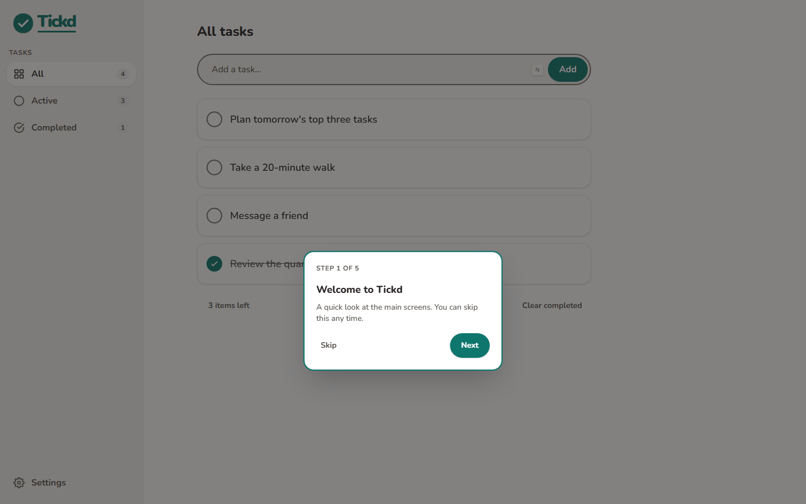
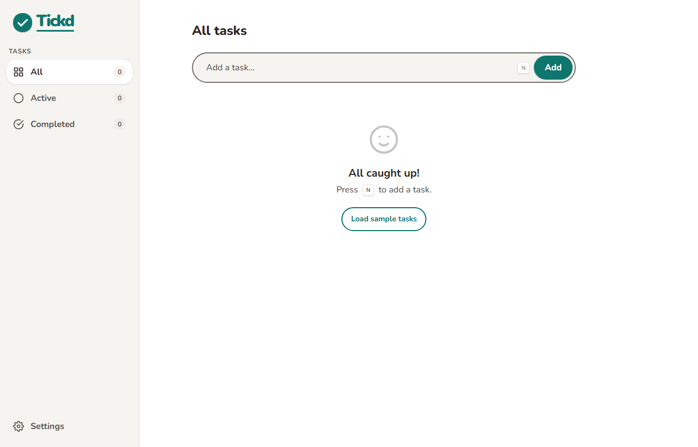
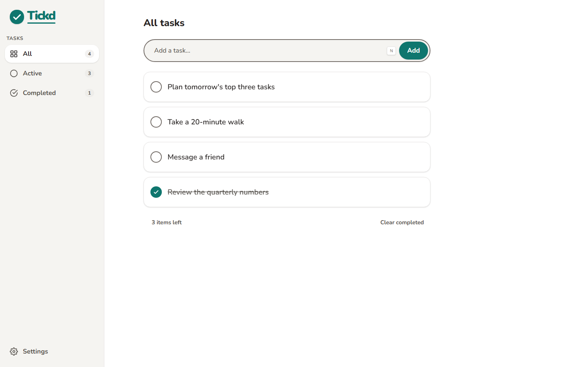
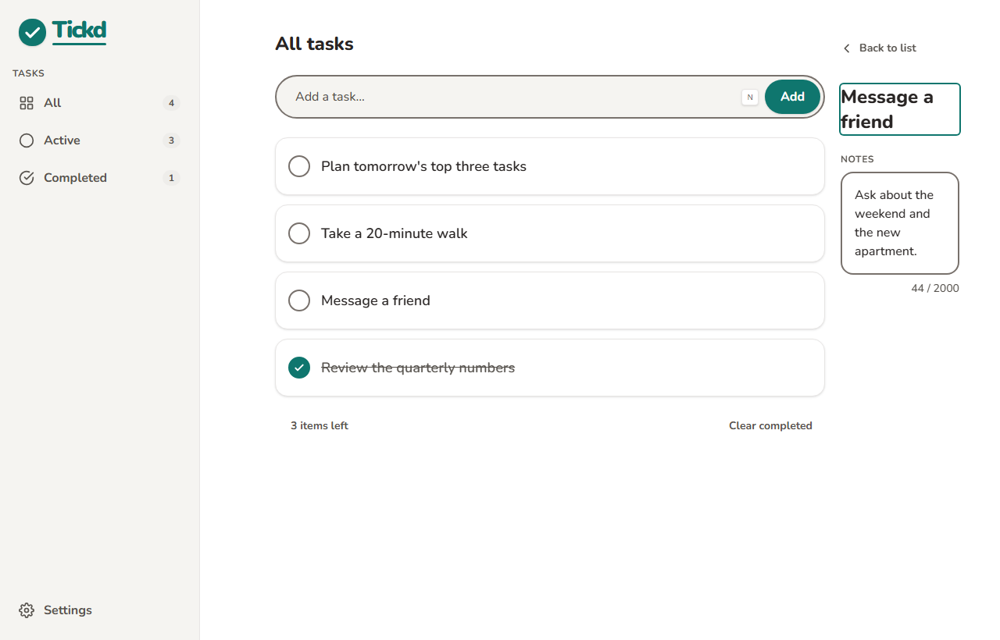
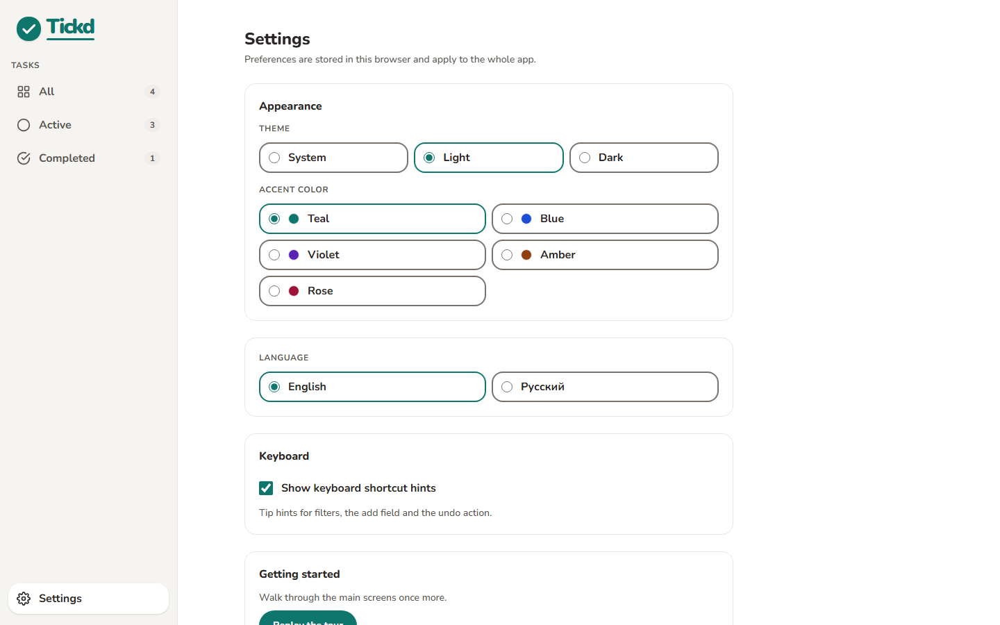
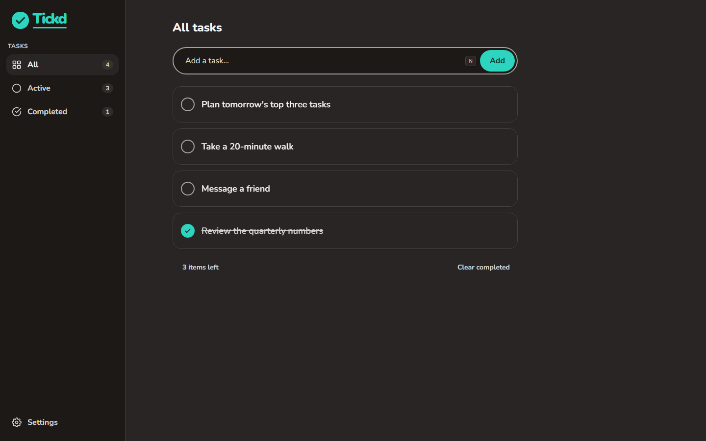
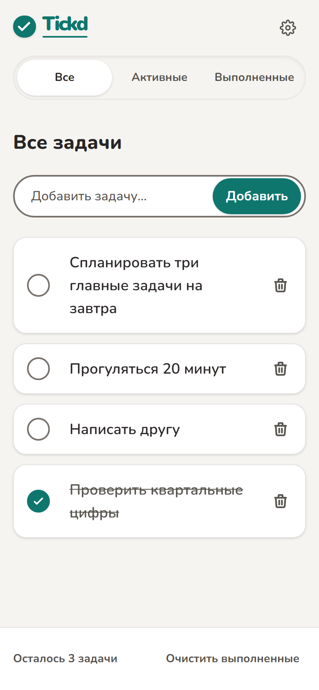
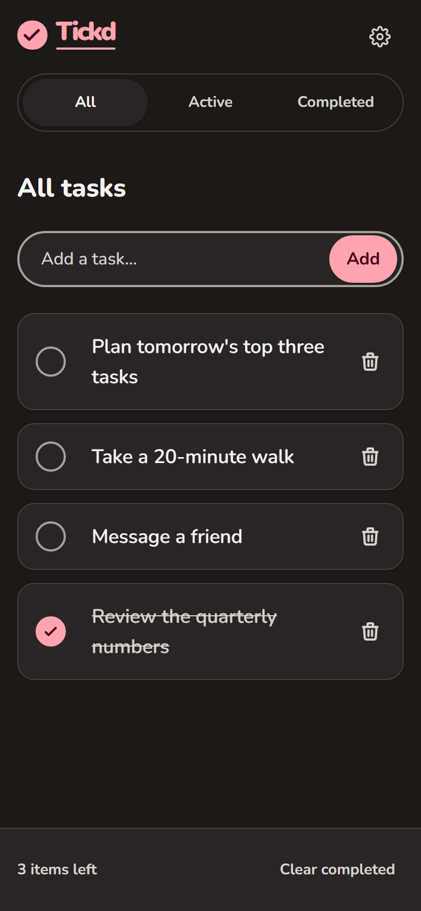

# Руководство пользователя

Tickd — список личных задач в браузере. Ни регистрации, ни установки: открыли страницу
и работаете. Задачи хранятся на устройстве пользователя, поэтому вход в аккаунт не нужен,
а данные не покидают браузер.

## Первый запуск

При первом открытии Tickd показывает короткое знакомство — несколько карточек с подсветкой
ключевых элементов интерфейса.

- **Далее** и **Назад** переключают шаги, **Пропустить** закрывает гид, `Esc` делает то же.
- Пройденное или пропущенное знакомство больше не появляется само.
- Вернуться к нему можно в настройках: «Пройти знакомство заново».

Если список пуст, на экране есть кнопка **«Загрузить примеры задач»**. Она добавляет три
задачи на текущем языке интерфейса. Их можно выполнять, переименовывать и удалять как
обычные; повторное нажатие кнопки дубликатов не создаёт. После этого задачи остаются
в списке, а кнопка исчезает.

## Добавление задач

1. Поставьте курсор в поле **«Добавить задачу…»** (или нажмите `/`, `N`).
2. Введите название и нажмите `Enter` или кнопку **«Добавить»**.

Правила, которые действуют всегда:

- Название короче или равно **200 символам**; счётчик под полем показывает, сколько уже
  набрано, и подсвечивается, когда лимит исчерпан.
- Пробелы по краям обрезаются. Задача только из пробелов не создаётся — под полем
  появляется сообщение «Задача не может быть пустой».
- При вставке из буфера переводы строк заменяются пробелами, а лишние пробелы
  внутри вставленного фрагмента схлопываются: задача остаётся одной строкой.
- Новая задача встаёт в конец списка.

## Работа со списком

| Действие             | Как сделать                                                   |
| -------------------- | ------------------------------------------------------------- |
| Отметить выполненной | Нажать на кружок слева от названия                            |
| Вернуть в работу     | Нажать на кружок ещё раз                                      |
| Открыть заметки      | Один клик по названию задачи                                  |
| Переименовать        | Двойной клик по названию или `Enter`, когда название в фокусе |
| Удалить              | Кнопка с корзиной справа от задачи                            |

После удаления внизу на 5 секунд появляется уведомление **«Задача удалена»** с кнопкой
**«Вернуть»**. Она возвращает задачу на прежнее место. Вернуть можно только последнее
удаление; после «Очистить выполненные» отмена не предлагается.

Внизу списка — счётчик активных задач («Осталось 3 задачи») и кнопка
**«Очистить выполненные»**, которая удаляет сразу все завершённые задачи и недоступна,
когда завершённых нет.

## Заметки к задаче

Клик по названию открывает карточку задачи. На широком экране она появляется справа,
на телефоне — во всю ширину вместо списка.

- В заметках можно хранить до **2000 символов**: контекст, ссылки, следующие шаги.
- Поле растёт вместе с текстом, а после определённой высоты начинает прокручиваться
  внутри, чтобы не растягивать страницу.
- Всё сохраняется автоматически при вводе. Кнопки «Сохранить» нет.
- **«К списку»** возвращает к тому же фильтру, из которого открыли задачу.

Адрес карточки можно сохранить или отправить: `…/tasks/<id>`. Если задачи с таким
адресом нет (её удалили или ссылка устарела), Tickd вернёт к списку.

## Фильтры

Слева на широком экране и сверху на телефоне — три представления:

- **Все** — весь список;
- **Активные** — только незавершённые;
- **Выполненные** — только завершённые.

Каждый фильтр — отдельный адрес (`/`, `/active`, `/completed`), поэтому кнопки браузера
«назад» и «вперёд» работают ожидаемо, а ссылку на нужный список можно передать.
На широком экране рядом с названием фильтра видно количество задач; на телефоне полоса
фильтров показывает только названия. Неизвестный адрес возвращает на «Все».

## Настройки

Раздел **«Настройки»** — в нижней части бокового меню на широком экране и по значку
шестерёнки на телефоне.

- **Тема** — «Системная», «Светлая», «Тёмная». Системная следует настройке операционной
  системы и меняется вместе с ней. Выбранная тема применяется сразу и не даёт вспышки
  при следующей загрузке страницы.
- **Акцентный цвет** — бирюзовый, синий, фиолетовый, янтарный, розовый. Акцент влияет
  на кнопки, ссылки, фокус и галочки; контраст проверен по WCAG AA.
- **Язык** — русский или английский. Переключается весь интерфейс, включая примеры задач
  и знакомство; формат дат и чисел в приложении не используется.
- **Подсказки горячих клавиш** — показывать или скрывать подсказки клавиш (`kbd`).
  Подсказки есть только на устройствах с мышью или трекпадом.
- **Пройти знакомство заново** — запускает гид с начала.

Настройки хранятся в браузере отдельно от задач и применяются ко всему приложению.

Тёмная тема доступна на всех экранах, включая телефон:

  

  
  

## Горячие клавиши

Работают, когда курсор не в поле ввода и не в заметках.

| Клавиша     | Действие                                    |
| ----------- | ------------------------------------------- |
| `/` или `N` | Перейти к полю добавления задачи            |
| `1`         | Фильтр «Все»                                |
| `2`         | Фильтр «Активные»                           |
| `3`         | Фильтр «Выполненные»                        |
| `Z`         | Вернуть последнюю удалённую задачу          |
| `Enter`     | Сохранить новую задачу или переименование   |
| `Esc`       | Отменить переименование, закрыть знакомство |

## Данные и их сохранение

- Задачи, заметки и настройки хранятся в **`localStorage`** браузера, на этом устройстве.
  Они не отправляются на сервер, и Tickd не требует аккаунта.
- У каждого браузера и профиля своё хранилище: в другом браузере список будет пустым.
- Очистка данных сайта, режим инкогнито и удаление профиля удаляют задачи без возможности
  восстановления. Резервного копирования и экспорта пока нет.
- Если браузер не разрешает запись (приватный режим, запрет хранилища), Tickd продолжает
  работать в памяти и предупреждает, что задачи не сохраняются.
- Если сохранённые данные повреждены или записаны несовместимой версией, Tickd начинает
  с пустого списка и сообщает об этом вместо падения.

## Известные ограничения

- Нет синхронизации между устройствами и вкладками.
- Нет сроков, напоминаний, повторов, проектов, поиска и статистики.
- Нет офлайн-режима и установки на домашний экран (PWA).
- Нет перетаскивания задач для изменения порядка.
- Нет импорта и экспорта данных.

Что планируется дальше — в [роадмапе](roadmap.md). Технические подробности —
в [обзоре архитектуры](architecture.md).
